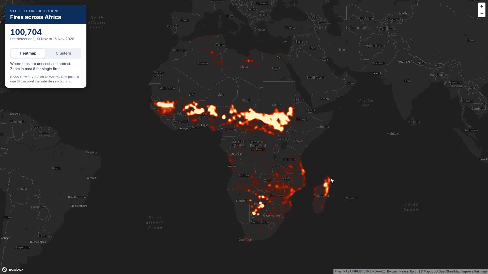

# Heatmaps and Clustering for 100k Points in Mapbox GL JS

Source code for the Geo Intelligence Lab video **"Heatmaps and Clustering for 100k Points in Mapbox GL JS"**.

A map of 100,704 satellite fire detections across Africa (13 to 16 November 2026), shown as a heatmap or as
clusters you can click into, built with React, TypeScript, Vite and Mapbox GL JS.



## What's inside

| Folder | What it is |
|---|---|
| [`starter/`](starter) | The broken version, with three bugs. Fix it with the video |
| [`final/`](final) | The finished app shown in the video |

The finished app covers:

- **Heatmap layer:** `heatmap-weight` from each fire's power, `heatmap-color` on `heatmap-density`
- **Clustering:** `cluster: true` on the GeoJSON source, a circle layer and a count label filtered on `point_count`
- **Two sources, one file:** the heatmap reads every fire, the clusters read the groups
- **Heat that survives zooming:** `heatmap-radius` is in screen pixels, so radius and intensity grow with zoom,
  and the heat hands over to single fires from zoom 7
- **Clusters are features too:** filter them out of the single-fire layer, and zoom into a clicked cluster with
  `getClusterExpansionZoom`

## Where each idea lives (`final/src`)

| File | What it teaches |
|---|---|
| `map/layers.ts` | Source names, the heatmap, the single fires, the cluster circles and their counts |
| `components/MapView.tsx` | Adds both sources and every layer, cluster clicks, fire popups, the mode switch |
| `map/popup.ts` | A fire's popup, built from text nodes |
| `components/Panel.tsx` | The count and the Heatmap / Clusters switch |
| `App.tsx` | Holds the mode |

## Run it

```bash
cd final              # or starter
npm install
cp .env.example .env  # put your public Mapbox token (pk.…) in .env
npm run dev
```

Then open http://localhost:5173.

## Data

Fire detections: NASA FIRMS, VIIRS 375 m on NOAA-20, from the global 7-day file downloaded on 17 November 2026,
kept for 13 to 16 November (UTC) and for points inside an African country. Each point is one 375 m pixel the
sensor flagged as fire; one fire can cover several pixels. `public/data/fires.geojson` is that snapshot.

To build your own from a fresh download of `J1_VIIRS_C2_Global_7d.csv` (https://firms.modaps.eosdis.nasa.gov/active_fire/)
and Natural Earth's `ne_50m_admin_0_countries.geojson`:

```bash
npm run data -- J1_VIIRS_C2_Global_7d.csv ne_50m_admin_0_countries.geojson 2026-11-13 2026-11-16
```

We acknowledge the use of data and imagery from NASA's Fire Information for Resource Management System (FIRMS)
(https://www.earthdata.nasa.gov/firms), part of NASA's Earth Science Data and Information System (ESDIS).
Borders: [Natural Earth](https://www.naturalearthdata.com/) (public domain).

## More

- Free GIS Developer Starter Kit: [geointelligencelab.com/toolkit](https://geointelligencelab.com/toolkit)
- YouTube: [@GeoIntelligenceLab](https://www.youtube.com/@GeoIntelligenceLab)
- Work with me: [geointelligencelab.com](https://geointelligencelab.com)
